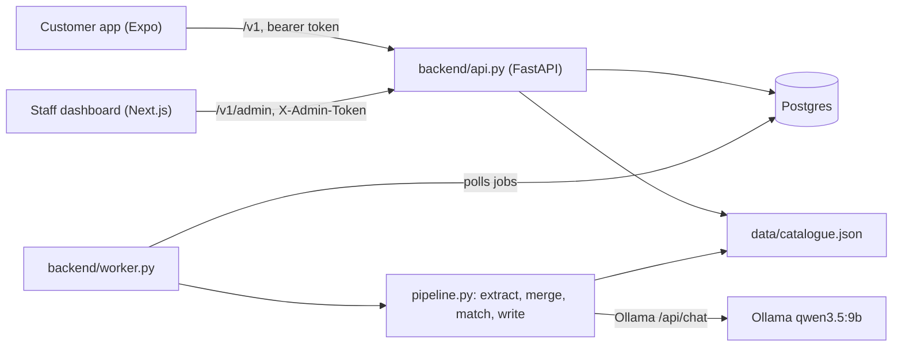

# If Life Partner: design

This file describes the system as the code builds it today. It covers the pipeline, the stack, the decisions that still hold and the colour palette.

## 1. What the system does

The customer uploads a home inspection report (a kuntotarkastus PDF). The backend reads facts about the house from it. It matches the facts against a risk catalogue. It shows a short risk list. Each risk has a reason, a benefit and up to 3 partners who can fix it. The backend also computes a maintenance list with due dates.

The main rule: **code decides, models read and write.**
- Code matches risks, sorts the list and picks the partners.
- The model extracts facts from the PDF and writes the reason and benefit texts.
- Severity, probability and points never come from a model. They come from the catalogue and from the fix rules.
- One exception: the write step may propose catalogue ids that code did not match (`proposed_additions`). Code keeps only ids that exist in the unmatched catalogue. The risk list shows these risks last, marked `llm_proposed`.

All numbers about score, tiers and money are mock data. Partners and partner confirmation are mock data too.

## 2. Parts

| Part | Does |
|---|---|
| `backend/api.py` | Customer endpoints, claim, CORS allow-list, `/health` |
| `backend/auth.py`, `presets.py` | Bearer token check and IP rate limit; the 50 preset homes |
| `backend/upload.py` | `POST /v1/homes/me/documents` |
| `backend/app_api.py` | The mobile app: `/v1/me/app`, bookings, reminders |
| `backend/admin.py` | Staff dashboard API under `/v1/admin` (staff login, classes, rules, bands, tiers, partners, simulate, demo reset) |
| `backend/engine.py` | Risk list, risk detail, fix points |
| `backend/maintenance.py` | Maintenance list |
| `backend/insurance.py` | Insurance scores, discount bands, tiers |
| `backend/pipeline.py`, `extract.py`, `write.py`, `llm.py` | The pipeline steps and the Ollama call |
| `backend/worker.py` | Runs queued jobs |
| `backend/db.py`, `models.py`, `migrations/` | SQLAlchemy models, seed, Alembic migrations |
| `scripts/catalogue/validate.py` | Validates the catalogue. Its `matches()` is the matcher the backend imports |
| `mobile-app/` | Customer app, Expo (React Native). Docker also serves a web build |
| `frontend/` | Staff dashboard, Next.js. It calls the backend from the server side only |

## 3. Stack

| Part | Choice |
|---|---|
| Customer app | Expo ~57, React Native 0.86, expo-router, TypeScript, Jest |
| Staff dashboard | Next.js 16, React 19, Tailwind 4 |
| Backend | Python 3.13, FastAPI, uvicorn, python-multipart |
| Database | Postgres 17 through SQLAlchemy 2.0. Alembic migrations in `backend/migrations/` run on container start (`backend/migrate.py`). Without `DATABASE_URL`, the backend uses a SQLite file `var/ilp.sqlite` (local runs and tests only) |
| Jobs | A `jobs` table. One worker process polls it. No queue server |
| PDF text | pypdfium2 |
| LLM | Ollama, `qwen3.5:9b` by default (`OLLAMA_MODEL`), called with httpx |
| Validation | jsonschema |
| Deployment | `docker-compose.yml`, 5 containers (below). Ollama runs on the host, not in a container |
| Dev shell | Nix flake (`flake.nix`) |
| Config | `.env` (not in git): `CUSTOMER_TOKEN` (required), `ADMIN_TOKEN`, `CORS_ORIGINS` (not needed for the app demo behind Caddy: it shares one origin with the API through nginx; only other browser origins need it), `OLLAMA_URL` (in compose `http://host.docker.internal:11434`; `127.0.0.1` would be the container itself), `EXPO_PUBLIC_API_URL` (public app URL, baked in at mobile build time; set it to `https://<APP_DOMAIN>`. The default `http://localhost:8082` points to a port no compose container publishes), `APP_DOMAIN` and `DASHBOARD_DOMAIN` (both required), `DATABASE_URL`, Postgres settings |

| Container | Role |
|---|---|
| `caddy` | `caddy:2-alpine`, `Caddyfile` at the repo root. The only container with host ports (80, 443). Gets HTTPS certificates itself. Routes `APP_DOMAIN` to `mobile` and `DASHBOARD_DOMAIN` to `frontend`. Public: the dashboard has its own staff login (see §5) |
| `postgres` | Postgres 17, the only database. Private `db` network, no host port |
| `backend` | FastAPI API (:8000) and job worker. Runs migrations on start. PDFs in the `backend-var` volume. Talks to Postgres and host Ollama |
| `frontend` | Staff dashboard, Next.js (:3000). Calls `/v1/admin` with `ADMIN_TOKEN` server-side |
| `mobile` | Web demo of the customer app: Expo static export on nginx (:80). nginx proxies `/v1/` to the backend |

## 4. Pipeline

1. **Upload.** `POST /v1/homes/me/documents` takes a multipart form with `file` and `type`. Only `type=kuntotarkastus` is accepted. The server checks the `%PDF-` magic bytes and the 20 MB limit. Ids are `doc_` or `job_` plus 16 hex characters. Neither app has an upload screen: uploads are API only. The app's nginx accepts bodies up to 21 MB so the backend answers oversize files with its own `too_large` error. It saves the file as `var/uploads/<document_id>.pdf` (never under the client filename). It inserts a `documents` row and a `jobs` row, both `queued`. It returns `202` with `document_id` and `job_id`.
2. **Run.** The worker takes the oldest queued job and sets it `running`. The client reads progress with `GET /v1/jobs/{id}` (`status`, `stage`, `error`).
3. **Extract** (`stage: extracting`). pypdfium2 reads the text. A PDF with no text layer fails the job (`no_text_layer`). One Ollama call gets the whole report text, with `prompts/extract.schema.json` as output format. The model returns field candidates with a value, a confidence and a quote. Code drops candidates whose value does not fit `data/home-profile.schema.json`.
4. **Merge** (code). Each candidate that is not `"unknown"` replaces the current field value, with `source: document`. Code builds `evidence` from the `document_id`, the quote and `page`. The page is the first PDF page whose text holds the quote. If no page holds it, `page` is left out. Code saves the profile.
5. **Match** (`stage: matching`, code). `matches(entry.applies_when, profile)` runs for each catalogue entry.
6. **Write** (`stage: writing`). With no matched entry, this step is skipped. Otherwise one Ollama call (`prompts/write.schema.json`) returns `why` and `benefit` for each matched entry, and may return `proposed_additions`. Code keeps only proposed ids from the unmatched list. If any remain, a second call writes their texts. Code saves all texts in `risk_texts`, with `llm_proposed` set for the second call's entries. If the model skips a matched entry, code uses the catalogue hint text. The model also flags doubts. Code writes the raw output and the doubt flags to the worker log only. Doubt flags change nothing else.
7. **Finish.** The job becomes `done` and the document `processed`. On any error both become `failed`, with an error code and message.

Limits:
- A job has a 180 s budget. Each Ollama call gets the remaining time as its timeout, and a slow model gives `timeout`.
- At start, the worker fails every job still `running` (`worker_restart`).
- Every Ollama call uses `POST /api/chat` with `stream: false`, `think: false`, `format` set to the schema, `temperature: 0` and `num_ctx: 16384`. The job fails (`llm_truncated`) when `done_reason` is `length`, `prompt_eval_count` comes within 512 of `num_ctx`, or it is far below the input size. A report over 150 pages, about 45,000 characters or about 14,000 estimated tokens fails with `document_too_long`. Without `think: false` and a larger `num_ctx`, output was cut on the test machine.

## 5. Risk list and partners

Code builds both from the profile, the catalogue and the database. No model is involved.

Endpoint shapes are in `docs/API.md`.

Customer auth is a bearer token: `CUSTOMER_TOKEN` opens the shared demo home `home_01`. Each of the 50 preset homes (`home_02` to `home_51`, own mock data) is claimed with a password through `POST /v1/claim`, which returns that home's token. Staff routes use the header `X-Admin-Token` (`ADMIN_TOKEN`). The dashboard has a login on top: 6 preset company accounts (`staff_accounts`), each claimed on first use. Passwords are hashed with scrypt. 5 wrong passwords lock an account and client IP for 60 s. Claims and staff logins are also limited to 20 attempts per minute per IP (429 `too_many_attempts`). Both counts live in process memory.

### Condition semantics

- A numeric test on `"unknown"` does not match.
- `in` matches `"unknown"` only when `"unknown"` is in the list.
- `exists` is false for `"unknown"`.
- So `not` over an unknown test is true. A missing record counts as at risk. Six catalogue entries rely on this.

## 6. Maintenance

The backend computes the list at each read and stores nothing. For each matched catalogue entry:
- Due date = base date + `check_interval_years`.
- Base date = the latest confirmed work order for that entry, else the date or year in the profile field named by the entry's `on_done`, else the profile creation date (`homes.created_at`).
- A due date is never before the profile creation date.
- Status is `overdue`, `upcoming` (due within 90 days) or `scheduled`.

The mobile app also shows seasonal `maintenance_tasks` for the demo customer. These come from `data/demo-person.json`. The customer can set a reminder on each task.

## 7. Data

| Table | Holds |
|---|---|
| `homes`, `profiles` | The demo home `home_01` and 50 preset homes, each with a profile (20 fields) |
| `documents`, `jobs` | Uploads and pipeline state |
| `risk_texts` | Written `why` and `benefit` per home and risk, and the `llm_proposed` flag |
| `work_orders`, `score_events` | Confirmed work for the catalogue risk list and maintenance |
| `customers`, `insured_objects` | The demo customer with a house, a summer cottage, a boat, a car and a dog, and 50 preset customers with a house each. A customer holds the password hash and token hash |
| `staff_accounts` | Dashboard logins (6). Password hash is null until claimed |
| `insurance_classes`, `insurance_settings`, `discount_bands`, `tiers` | Score model, edited by staff |
| `fix_rules` | Points and half-life of a fix in a context. Staff set the points by hand per rule |
| `assigned_risks`, `bids`, `bookings`, `maintenance_tasks`, `reminders` | Mobile app content and state |
| `partners` | Mock partners, edited by staff |

A profile field looks like `{"value": 1975, "confidence": 0.9, "source": "document", "evidence": {"document_id": "doc_01", "page": 3, "quote": "..."}, "doubt": false}`. An unfilled field has `value: "unknown"`. The pipeline always sets `doubt: false`.

Static files:

| File | Holds |
|---|---|
| `data/catalogue.json` | 20 risk entries, built from `data/catalogue/<category>/<name>.json`. Id and category come from the path |
| `data/home-profile.schema.json` | The 20 profile fields and their allowed values |
| `data/score-model.json` | Seed for the score model |
| `data/demo-person.json` | The demo customer. The backend refreshes it from this file at every start |
| `fixtures/partners.json` | Mock partner seed (27 partners) |

### Score model (seeded from `data/score-model.json`)

- Each insurance starts at 500 and can reach 1000.
- The insurance score sets the discount on that insurance: 500 gives 5 %, 700 gives 10 %, 900 gives 15 %.
- The Care Score is the average of the insurance scores. It sets the tier.

| Tier | Starts at | Partner discount |
|---|---|---|
| Bronze | 0 | 5 % |
| Silver | 500 | 10 % |
| Gold | 700 | 15 % |
| Platinum | 850 | 20 % |

Tier bonuses are display texts only. A fix earns the points of its `fix_rules` row, decayed: `points * 0.5 ** (years / half_life_years)`, with years counted from the confirmation date. Without a half-life or a date there is no decay.

`scripts/reset-demo.sh` clears demo bookings and reminders and unclaims staff accounts. Homes stay claimed.

## 8. Risks of the design

| Risk | Handling |
|---|---|
| The model invents or misreads a fact | Output must match the schema. Each value needs a quote. Code checks the value against the profile schema and finds the page of the quote |
| The model proposes a wrong risk | Code accepts only existing unmatched ids and shows them last, marked `llm_proposed` |
| The output is cut | The job fails on `done_reason: length` or a full context |
| A scanned PDF has no text | The job fails with `no_text_layer` |
| A job hangs | 180 s limit. Stale `running` jobs fail at worker start |
| A bad upload | Magic bytes, 20 MB limit, server-side filename |
| Browser access from other sites | CORS allow-list from `CORS_ORIGINS` |

## 9. Decisions that still hold

| Topic | Decision |
|---|---|
| Catalogue format | JSON, one file per entry, checked by `validate.py` with per-entry `tests.match` and `tests.reject` |
| Raw model data | Raw output goes to the worker log. The database stores only what the endpoints need |
| RAG | Not used. Matched entries go into the prompt directly |
| Language | English |
| Mocked | Fraud-proof verification, real premium changes, a real partner network, strong e-ID, partner confirmation |

## 10. Colour palette

The tokens are in `mobile-app/src/lib/theme.ts` (app) and `frontend/src/app/globals.css` (dashboard). The roles are our choice. The hex values come from the If design system.

- **App (warm).** Beige page, white cards, dark brown text. One blue (`#0054F0`) carries every action. Yellow and red mark status only. Good news is deep blue (`#1241A2`), not green.
- **Dashboard (cool).** The same blue, tier and state colours, with cooler neutrals. Success is green.
- **Tiers (both).** Bronze `#D16547`, Silver `#9F948F`, Gold `#E9AD25`, Platinum `#0054F0`. Show a tier colour as a dot or ring next to the tier name, never alone. Gold on white has a contrast ratio of 2.0:1, so use it for graphics only.
- No dark mode. No If typeface or logo.
