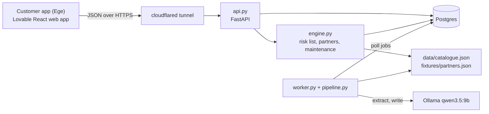

# If Life Partner: system design (phase 1, proof of concept)

Status: 2026-10-17. This is the only design document. It holds what we build now. Everything for later is in `docs/systemdesign/LATER.md`.
Related files:
- `docs/iflifepartner.md`: what the service is.
- `docs/systemdesign/api-contract.md`: the endpoint shapes. Antton owns it and does the integration.
- `docs/systemdesign/decisions.md`: the decision log.

## 1. Summary

The customer uploads a home inspection report (kuntotarkastus PDF). The backend extracts facts about the house, matches them against a risk catalogue and shows a short risk list with a reason and a benefit for each risk. For each risk it shows partners who can fix it. It also shows a maintenance list with due dates.

The rule of the design: **code decides, models read and write.**
- Code matches risks, orders the list and picks the partners.
- The model extracts facts from the PDF and writes the reason and benefit texts.
- Severity, probability and points come from the catalogue only.

Goal of phase 1: a working proof of concept. No tests beyond what exists, no optimisation.

## 2. Scope

| Group | Content |
|---|---|
| Core | Upload a PDF, wait for the job, see the risk list, see one risk with partners, see the maintenance list |
| Last, maybe | Book a partner, partner confirms, care score rises |

Sample input: the synthetic reports in `samples/synthetic/`. Everything is in English.

## 3. Architecture

All backend parts run on pc-btw.

| Module | Does |
|---|---|
| `backend/api.py` | The endpoints, the bearer token check, CORS, the upload |
| `backend/db.py` + `backend/models.py` | Opens the database through SQLAlchemy, creates the tables from the models, seeds `home_01`, the fix rules and the settings |
| `backend/engine.py` | Builds the risk list, picks the partners, computes the maintenance dates. Later: booking, confirm, score |
| `backend/pipeline.py` | The Ollama calls and the steps extract → merge → match → write |
| `backend/worker.py` | Takes the next queued job, runs the pipeline, sets `status` and `stage` |
| `scripts/catalogue/validate.py` | Exists. Validates the catalogue and builds `data/catalogue.json`. Its `matches()` is the matcher the backend imports |

## 4. Stack

| Part | Choice |
|---|---|
| Customer app | Lovable (React, TypeScript, Tailwind) web app in Chrome on the Pixel. No Supabase. |
| Backend | Python 3.13, FastAPI, uvicorn, python-multipart |
| Database | Postgres 17 in docker compose, through SQLAlchemy 2.0 (models in `backend/models.py`). `DATABASE_URL` picks it; without it, a SQLite file `var/ilp.sqlite` (local runs, tests). Only the backend connects to it; the staff dashboard uses `/v1/admin`. |
| Jobs | A `jobs` table. One worker process polls it. No queue server. |
| PDF text | pypdfium2 |
| LLM | Ollama on pc-btw, `qwen3.5:9b`, called with httpx |
| Validation | jsonschema |
| Dev shell | Nix, from nixpkgs. A `backend` shell in the root `flake.nix` |
| Reachability | `cloudflared tunnel --url http://localhost:8000`. The tunnel gives HTTPS. The backend listens on `127.0.0.1:8000`. |
| Config | `.env`: Ollama address, CORS origins, demo tokens. Not in git. |

## 5. Database

Postgres (SQLite without `DATABASE_URL`). One demo customer and one home (`home_01`).
Added 2026-10-17 for the staff dashboard and the five insurance classes: `customers` and `insured_objects` (the demo customer owns a house, a summer cottage, a boat, a car and a dog; a house keeps its profile in `profiles`, the others in `insured_objects.profile`), `insurance_classes` (base premium per class), `fix_rules` (points and half-life of a fix in a context), `insurance_settings` (the starting insurance score, the maximum), `discount_bands` (insurance score → percent off that insurance) and `tiers` (aggregate score → bonuses). Score model, seeded from `data/score-model.json`: each insurance starts at 500 and has its own score up to 1000, which sets its discount (500+: 5 %, 700+: 10 %, 900+: 15 %); the Care Score is the average of the insurance scores and sets the tier, whose bonuses are display texts. This replaces the mock model of decisions 26 and 30 for the demo; `fixtures/score-tiers.json` stays for `/homes/me/score`. The house risks come from `data/catalogue.json`; the other classes from the mock `data/insurance-classes.json`, two risks each (`backend/insurance.py`). All numbers are mock data.

| Table | Columns | Written by |
|---|---|---|
| `homes` | `home_id`, `street`, `postal_code`, `city`, `created_at` | seed |
| `profiles` | `home_id`, `profile` (JSON, 20 fields), `updated_at` | seed, worker |
| `documents` | `document_id`, `home_id`, `type`, `uploaded_at`, `status` (`queued`, `processed` or `failed`) | api, worker |
| `jobs` | `job_id`, `document_id`, `status`, `stage`, `started_at`, `finished_at`, `error` | api, worker |
| `risk_texts` | `home_id`, `risk_id`, `why`, `benefit`, `llm_proposed`, `generated_at` | worker |
| `work_orders` (maybe) | `work_order_id`, `home_id`, `risk_id`, `partner_id`, `status`, `created_at`, `confirmed_at` | api |
| `score_events` (maybe) | `event_id`, `home_id`, `at`, `delta`, `reason`, `work_order_id` | api |

- The uploaded PDF is saved as `var/uploads/<document_id>.pdf`.
- The seed creates `home_01` (Esimerkkikatu 3, 20100 Turku) with every profile field `"unknown"`. The profile creation date is `homes.created_at`.
- The seed also writes the score event `Home profile created` with `delta` 0 (for the score, maybe).
- To reset: delete `var/` and seed again.

Static data, read from files (these exist):

| File | Holds |
|---|---|
| `data/catalogue.json` | 20 risk entries, built by `validate.py` from `data/catalogue/<category>/<name>.json` |
| `data/home-profile.schema.json` | The 20 profile fields and their allowed values |
| `fixtures/partners.json` | 15 mock partners |
| `fixtures/score-tiers.json` | Mock tiers and rewards (for the score, maybe) |
| `fixtures/half-lives.json` | Mock decay half-lives (for the score, maybe) |

A profile field looks like `{"value": 1975, "confidence": 0.9, "source": "document", "evidence": {"document_id": "doc_01", "page": 3, "quote": "..."}, "doubt": false}`. An unfilled field has `value: "unknown"`. Phase 1 always sets `doubt: false`; the doubt rules are in `LATER.md` §2.

## 6. Pipeline

1. `POST /homes/me/documents` checks the PDF magic bytes and the 20 MB limit, saves the PDF under `document_id`, inserts a `documents` row and a `jobs` row (both `queued`), and returns `job_id`.
2. The worker takes the job and sets `status: running`.
3. **Extract** (`stage: extracting`): pypdfium2 reads the text. A PDF with no text layer fails the job (scanned PDFs are later work). One Ollama call per unit, with `prompts/extract.md` and `prompts/extract.schema.json`. A report under 20,000 characters is one unit; a longer report splits at the top-level KH sections (decision 35, `prompts/extract.md` "Chunking rule"). The demo report is one unit. The model returns field candidates with a value, a confidence and a quote.
4. **Merge** (code): each candidate that is not `"unknown"` replaces the current field value, with `source: document`. Code builds `evidence` from the `document_id`, the quote, and `page`: the first PDF page whose text holds the quote. When no page holds it, `page` is left out. Save the profile.
5. **Match** (`stage: matching`, code): `matches(entry.applies_when, profile)` for each catalogue entry.
6. **Write** (`stage: writing`): one Ollama call with `prompts/write.md` and `prompts/write.schema.json`. The model returns `why` and `benefit` for each matched entry. It may also propose unmatched catalogue ids. Code keeps only proposed ids from the unmatched list. When any remain, a second call with the same prompt passes those entries in full as `matched`, with their triggering facts from `condition_leaves()`; it writes their `why` and `benefit`. Save all texts in `risk_texts`, with `llm_proposed` set for the second call's entries. The raw model text and the `doubt` flags go to the worker log only (decision 11).
7. The worker sets the job to `done` and the document to `processed`, or both to `failed` with an error.

Job time limit: the worker fails a job after 180 s. On start, the worker fails every job that is still `running`. The app stops polling after 200 s and offers a retry.

The app polls `GET /jobs/{id}` every 2 s.

Every Ollama call: `POST /api/chat`, `stream: false`, `think: false`, `format` = the schema, `options: {temperature: 0, num_ctx: 16384}`. Without `think: false` and `num_ctx`, the output is cut. This was measured on pc-btw. The job fails when `done_reason` is `length` or `prompt_eval_count` reaches `num_ctx` (decision 35).

## 7. Endpoints and rules

Shapes are in `api-contract.md`. Example responses for each endpoint are in `fixtures/api/`.

| Endpoint | What code does | Group |
|---|---|---|
| `GET /homes/me` | Returns the home, the profile and the documents | core |
| `POST /homes/me/documents` | Accepts a PDF up to 20 MB, starts a job | core |
| `GET /jobs/{id}` | Returns the job row | core |
| `GET /homes/me/risks` | Matched entries with their texts. Sorted by `severity × probability`, LLM-proposed last. At most 5 | core |
| `GET /homes/me/risks/{id}` | The risk, its evidence (the quotes of the profile fields its condition uses), and up to 3 partners: same `partner_category`, same city, `if_vetted`, by rating | core |
| `GET /homes/me/maintenance` | Computed at each read, nothing stored. For each matched entry: due date = base date + `check_interval_years`. The base date is the last known date for that part (a confirmed work order or a profile fact), or the profile creation date when nothing is known. A due date is never before the profile creation date. Status: `overdue`, `upcoming` (within 90 days) or `scheduled` | core |
| `POST`, `GET /homes/me/work-orders` | Books a partner. The risk becomes `booked`. `409` when the risk is already `booked` or `done`, or the partner does not serve the risk's `partner_category` | maybe |
| `POST /work-orders/{id}/confirm` | Partner token, fired with curl. The risk becomes `done`, a score event is added, the entry's `on_done` fact goes into the profile with `source: partner`. One transaction. A second confirm returns `409` and adds no event. An entry earns points at most once per `check_interval_years` | maybe |
| `GET /homes/me/score` | Score = 1000 + the sum of decayed points from confirmed jobs − penalties. Decay uses the mock half-lives. Phase 1 has no penalties. Tier and reward from `fixtures/score-tiers.json` | maybe |

Auth: one bearer token for the demo customer and one partner token, both from `.env`.

## 8. Left to the code for now

These points are not specified. The developer decides them while coding. They do not block the demo.
- A job with no matched risk: the worker may skip the write step. The app shows an empty list.
- Maintenance base date: the developer picks a simple rule. Fixtures may differ from it.
- Both processes open the database through `db.connect()`. On Postgres an advisory lock lets only one of them create the tables; on SQLite it sets WAL and a busy timeout.
